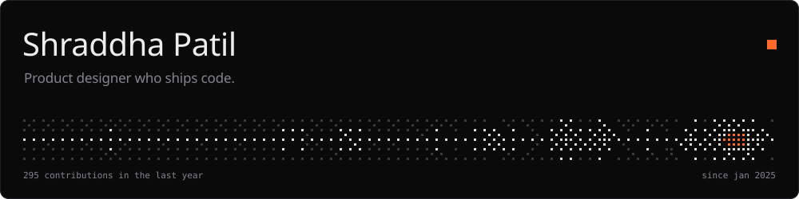
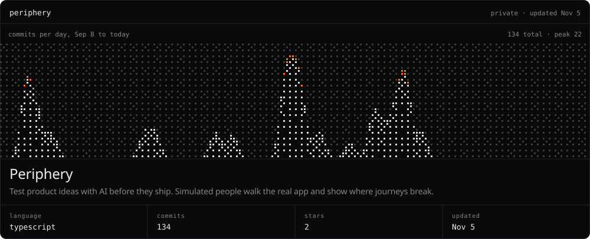
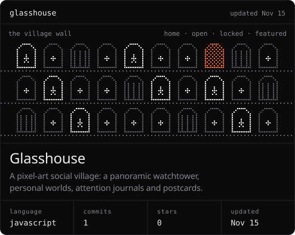
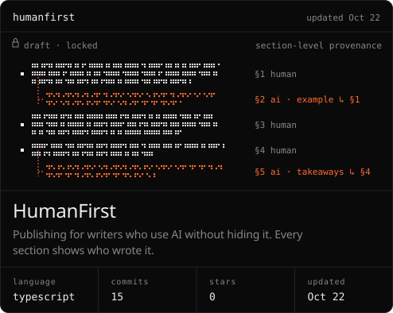
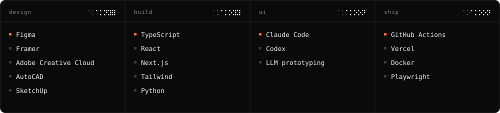
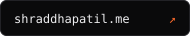
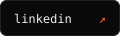

### Hi, I'm Shraddha

I'm a product designer working where design, technology and human behavior meet. I design in Figma, then build the real thing in code, because a design isn't done until it runs.

- `now` &nbsp; building **Periphery**, a tool for testing product ideas with AI before they ship
- `learning` &nbsp; MSIS student, building with LLMs and exploring human–AI interaction
- `ask me about` &nbsp; AI-native design, conversational UX, design systems, prototyping in code
- `writing` &nbsp; how designers work now that AI is in the room

### Projects

### Tools

### Writing

<!-- writing:start -->
| | title | published |
|:--|:--|--:|
| `01` | [The Designer’s Job Didn’t Disappear. It Just Got Harder to Hide From.](https://medium.com/@patilshraddhaa21/the-designers-job-didn-t-disappear-it-just-got-harder-to-hide-from-1c8cc1f3fd54) | `Jun 3, 2026` |
| `02` | [Most designers are using AI. Few are designing AI-natively.](https://medium.com/@patilshraddhaa21/most-designers-are-using-ai-few-are-designing-ai-natively-c1827215df15) | `Jun 2, 2026` |
<!-- writing:end -->

### Connect

 

The header, project cards and writing update daily from live GitHub and Medium data: <a href="scripts/render.py">render.py</a> · <a href=".github/workflows/render.yml">workflow</a>
